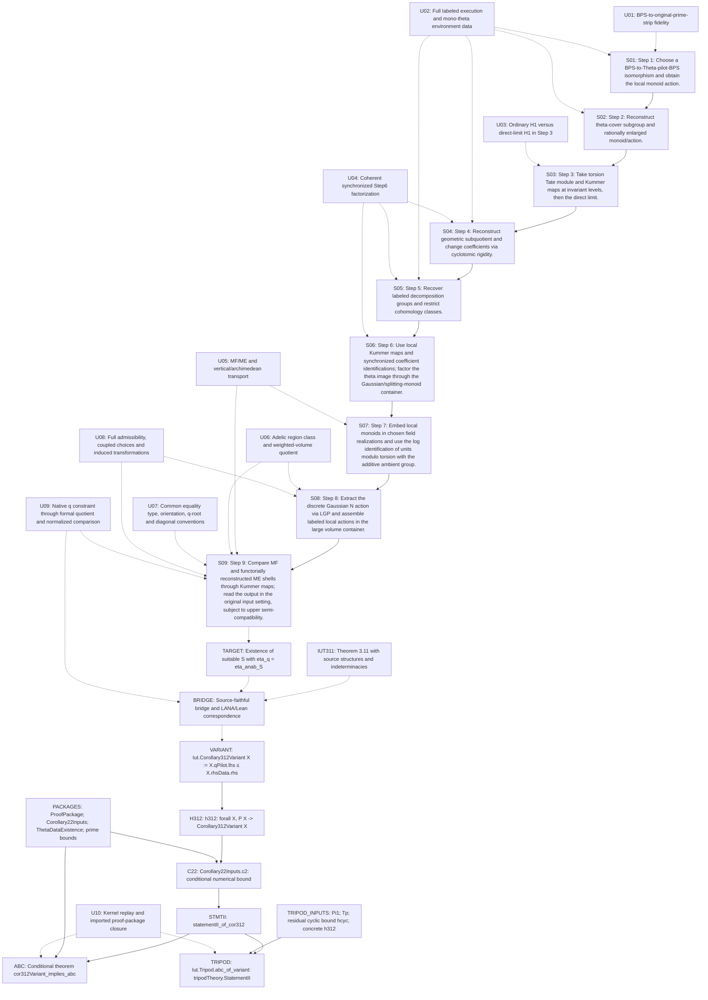

# Dependency DAG

**RECONSTRUCTION:** Edges distinguish construction dependencies, explicit code hypotheses and unresolved correspondences. No path proves TARGET ★. Acyclicity describes this audit workflow; it is not a claim that the actual log-theta lattice is acyclic. Full lexical import/declaration data are in the LANA audit inventories.

## Edge semantics

- U01 → S01: unresolved typing or fidelity obligation [UNRESOLVED].
- U02 → S01: unresolved typing or fidelity obligation [UNRESOLVED].
- S01 → S02: construction prerequisite [RECONSTRUCTION].
- U02 → S02: unresolved typing or fidelity obligation [UNRESOLVED].
- S02 → S03: construction prerequisite [RECONSTRUCTION].
- U03 → S03: unresolved typing or fidelity obligation [UNRESOLVED].
- S03 → S04: construction prerequisite [RECONSTRUCTION].
- U02 → S04: unresolved typing or fidelity obligation [UNRESOLVED].
- U04 → S04: unresolved typing or fidelity obligation [UNRESOLVED].
- S04 → S05: construction prerequisite [RECONSTRUCTION].
- U02 → S05: unresolved typing or fidelity obligation [UNRESOLVED].
- U04 → S05: unresolved typing or fidelity obligation [UNRESOLVED].
- S05 → S06: construction prerequisite [RECONSTRUCTION].
- U04 → S06: unresolved typing or fidelity obligation [UNRESOLVED].
- S06 → S07: construction prerequisite [RECONSTRUCTION].
- U05 → S07: unresolved typing or fidelity obligation [UNRESOLVED].
- S07 → S08: construction prerequisite [RECONSTRUCTION].
- U06 → S08: unresolved typing or fidelity obligation [UNRESOLVED].
- U08 → S08: unresolved typing or fidelity obligation [UNRESOLVED].
- S08 → S09: construction prerequisite [RECONSTRUCTION].
- U05 → S09: unresolved typing or fidelity obligation [UNRESOLVED].
- U06 → S09: unresolved typing or fidelity obligation [UNRESOLVED].
- U07 → S09: unresolved typing or fidelity obligation [UNRESOLVED].
- U08 → S09: unresolved typing or fidelity obligation [UNRESOLVED].
- U09 → S09: unresolved typing or fidelity obligation [UNRESOLVED].
- S09 → TARGET: map construction needed before stating existence target [UNRESOLVED].
- IUT311 → BRIDGE: correspondence/derivation not reconstructed [UNRESOLVED].
- TARGET → BRIDGE: LANA asserted relevance; no formal equivalence certified [UNRESOLVED].
- U09 → BRIDGE: native-q and formal-quotient obligation [UNRESOLVED].
- BRIDGE → VARIANT: missing source-faithfulness derivation; NOT a proved implication [UNRESOLVED].
- VARIANT → H312: proposition occurring in hypothesis, NOT a proof [RECONSTRUCTION].
- H312 → C22: explicit bridge hypothesis required [RECONSTRUCTION].
- PACKAGES → C22: additional explicit packages required [RECONSTRUCTION].
- C22 → STMTII: conditional source-code use [RECONSTRUCTION].
- STMTII → ABC: statementII_implies_statementI with ProofPackage [RECONSTRUCTION].
- PACKAGES → ABC: additional explicit hypotheses [RECONSTRUCTION].
- U10 → ABC: kernel and imported-axiom certification outstanding [UNRESOLVED].
- STMTII → TRIPOD: conditional source-code use with constructed concrete inputs [RECONSTRUCTION].
- TRIPOD_INPUTS → TRIPOD: explicit remaining hypotheses [RECONSTRUCTION].
- U10 → TRIPOD: kernel and imported-axiom certification outstanding [UNRESOLVED].

## Node provenance

- U01: LANA;IUT2, §4.1 p.23; IUT2 Definition 4.9(viii) p.158 [UNRESOLVED].
- U02: LANA;IUT2;ET, LANA §6.2 pp.33–36; IUT2 Proposition 1.5; ET Corollary 2.19 [UNRESOLVED].
- U03: LANA, §6.1 pp.31–32; §9.1(c) p.44; Figure 6 [UNRESOLVED].
- U04: LANA;IUT2;ET, LANA §9.1(f) p.45; §6.2(g) pp.35–36; IUT2 Corollary 4.10 [UNRESOLVED].
- U05: IUT3;LANA, IUT3 Proposition 3.5(ii), Theorem 3.11(ii) pp.155–156; LANA §9.1(g)–(i) p.45 [UNRESOLVED].
- U06: LANA;IUT3, LANA §9.2 p.46; IUT3 Remark 3.1.1 pp.94–96; Proposition 3.9 pp.115–117 [UNRESOLVED].
- U07: LANA;IUT3, LANA pp.24,26,46; IUT3 xi-d/e pp.183–184 [UNRESOLVED].
- U08: IUT3;LANA, IUT3 Theorem 3.11 pp.153–158; LANA §§9–10 pp.44–49 [UNRESOLVED].
- U09: IUT3;ELS;FORM, IUT3 cQ3/cQ4 pp.141–143; xi-d–f pp.183–184; ELS Stp7–8 pp.151–156; FORM pp.10–11 [UNRESOLVED].
- U10: LCODE, Iut/Implication/Corollary23.lean:119–125; lake-manifest.json @ 2d8f000457da6447fa4df4bfec7365c1a49b6384 [UNRESOLVED].
- S01: LANA;IUT2, LANA §9.1(a) p.44; §6.2(b) p.33 [SOURCE_CLAIM_ONLY].
- S02: LANA;IUT2, LANA §9.1(b) p.44; §6.2(c)–(d) pp.33–34 [SOURCE_CLAIM_ONLY].
- S03: LANA, LANA §9.1(c) p.44 versus Figure 6 p.44; §6.1 pp.31–32 [SOURCE_CLAIM_ONLY].
- S04: LANA;IUT2;ET, LANA §9.1(d) p.45; §6.2(e) p.35; IUT2 p.29; ET p.58 [SOURCE_CLAIM_ONLY].
- S05: LANA, LANA §9.1(e) p.45; §6.2(f) p.35 [SOURCE_CLAIM_ONLY].
- S06: LANA;IUT2;ET, LANA §9.1(f) p.45; §6.2(g) pp.35–36; IUT2 pp.29–30,158–159; ET p.58 [SOURCE_CLAIM_ONLY].
- S07: LANA;IUT3, LANA §9.1(g) p.45; §5.1 pp.26–28; IUT3 Proposition 1.2 pp.32–33 [SOURCE_CLAIM_ONLY].
- S08: LANA;IUT3, LANA §9.1(h) p.45; §6.2(h)–(i) p.36; §5.2 pp.28–29 [SOURCE_CLAIM_ONLY].
- S09: LANA;IUT3;ELS, LANA §9.1(i) p.45; §7.2(c) pp.39–40; IUT3 pp.155–156 [SOURCE_CLAIM_ONLY].
- TARGET: LANA, §9.2 equation (9-1), PDF p.46 [UNRESOLVED].
- IUT311: IUT3, pp.153–158 [SOURCE_CLAIM_ONLY].
- BRIDGE: IUT3;LANA;LCODE, IUT3 xi-d–f pp.183–184; LANA §9.2; Iut/Cor312/Statement.lean:43–52 [UNRESOLVED].
- VARIANT: LCODE, Iut/Cor312/Statement.lean:89–91 @ 2d8f000457da6447fa4df4bfec7365c1a49b6384 [VERIFIED_PRIMARY].
- H312: LCODE, Iut/Implication/Corollary23.lean:119–125 @ 2d8f000457da6447fa4df4bfec7365c1a49b6384 [VERIFIED_PRIMARY].
- PACKAGES: LCODE, Iut/Implication/Corollary23.lean:119–125 @ 2d8f000457da6447fa4df4bfec7365c1a49b6384 [VERIFIED_PRIMARY].
- C22: LCODE, Iut/Implication/Corollary22.lean:384 onward @ 2d8f000457da6447fa4df4bfec7365c1a49b6384 [VERIFIED_PRIMARY].
- STMTII: LCODE, Iut/Implication/Corollary23.lean:56–112 @ 2d8f000457da6447fa4df4bfec7365c1a49b6384 [VERIFIED_PRIMARY].
- ABC: LCODE, Iut/Implication/Corollary23.lean:119–125 @ 2d8f000457da6447fa4df4bfec7365c1a49b6384 [VERIFIED_PRIMARY].
- TRIPOD_INPUTS: LCODE, Iut/Tripod/Main.lean:78–79,125–143 @ 2d8f000457da6447fa4df4bfec7365c1a49b6384 [VERIFIED_PRIMARY].
- TRIPOD: LCODE, Iut/Tripod/Main.lean:125–143 @ 2d8f000457da6447fa4df4bfec7365c1a49b6384 [VERIFIED_PRIMARY].
